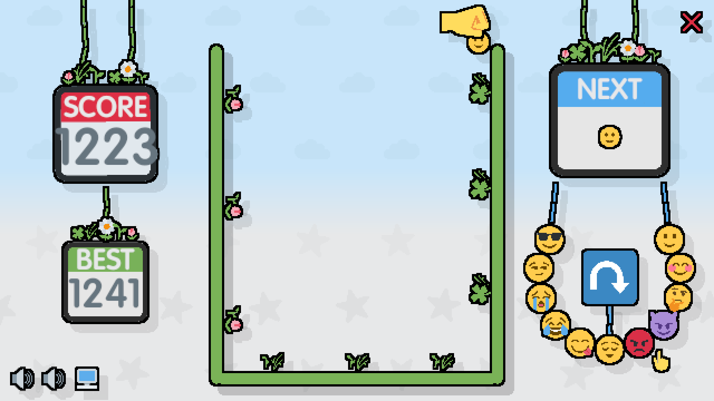

# bevy_gamekit

**🎮 Play the demo:** <https://cupnfish.github.io/bevy_gamekit/> — a Bevy 0.20
recreation of [emoji-merge](https://github.com/a327ex/emoji-merge), and the test
vehicle for the crates below.

**bevy_gamekit** is a Bevy toolkit: a workspace of reusable crates for
**building**, **testing via agents**, and **shipping Bevy games to Mini Game
hosts**.

1. **Agent harness** (`bevy_agent_harness` + the `bevy-agent` CLI) — drive a
   *running* Bevy game, read its state, assert on it, and capture screenshots.
   Built for test automation and LLM agents.
2. **Mini Game toolchain** (`bevy_minigame`, `bevy_minigame_douyin`,
   `bevy_minigame_wechat`, `bevy_minigame_wasm_split`) — package a Bevy WebGL
   build as a Douyin or WeChat Mini Game, with Wasm splitting and Brotli
   compression to fit package size limits.

## Test game: `bevy_emoji`

The crates are developed and exercised against **`bevy_emoji`** — a from-scratch
Bevy 0.20 + Avian recreation of [**emoji-merge**][upstream-src] by
[`a327ex`][a327ex], the Suika-style game about dropping and merging emojis. It
is the root package of this workspace (binary `bevy_emoji`) and the demo / test
vehicle for the toolkits above. The original is Lua on LÖVE; this port is Rust
on **Bevy 0.20** + **Avian** (2D physics) + Bevy's built-in `bevy::audio`.
Gameplay rules, emoji set, and art assets are reused from the original under its
license; none of the original Lua code is.

- ▶️ Play the original: <https://a327ex.itch.io/emoji-merge>
- 📦 Original source: <https://github.com/a327ex/emoji-merge>



---

See [Workspace crates](#workspace-crates) for the full inventory.

## Run locally

> **Assets:** The game loads art and audio from `emoji-merge/assets`, which is
> gitignored — it's the upstream project, kept as a separate checkout rather
> than redistributed here. Fetch it once before running locally:
>
> ```sh
> git clone https://github.com/a327ex/emoji-merge
> ```
>
> (The GitHub Pages workflow fetches this automatically for deploys.)

Native:

```sh
cargo run
```

Web:

```sh
rustup target add wasm32-unknown-unknown
cargo install trunk --version 0.21.14
trunk serve --release
```

Open <http://127.0.0.1:8080/>. Mouse and touch input are detected from the
active pointer, so hybrid devices can switch between them while the game is
running.

## Deploy targets

### GitHub Pages

**Live site:** <https://cupnfish.github.io/bevy_gamekit/>

The workflow in `.github/workflows/pages.yml` builds and deploys the game on
pushes to `main` or `master`. On its first run it enables GitHub Pages for you
(source = **GitHub Actions**), so no manual repository setup is needed. The
workflow fetches the pinned upstream `emoji-merge` assets before running the
Trunk release build.

The in-game screen button requests browser fullscreen and landscape orientation
when the browser allows it. Older iOS Safari versions do not expose the
Fullscreen API for arbitrary canvas elements; on those versions, use **Add to
Home Screen** for the closest full-screen experience.

### Douyin Mini Game

Install the matching wasm-bindgen CLI once (its version must match `Cargo.lock`
exactly):

```powershell
cargo install -f wasm-bindgen-cli --version 0.2.126 --locked
```

Build and package in one step:

```powershell
.\scripts\build-douyin.ps1 -AppId "tt<your-douyin-app-id>"
```

The result is written to `dist-douyin/emoji`. Import that directory in the
official Douyin Developer Tool as a Mini Game. The script downloads the pinned
Binaryen `wasm-opt` release on first use, verifies its SHA-256 checksum, splits
the Bevy call graph, runs `wasm-opt -Oz`, and Brotli-compresses the main and
deferred Wasm modules. Packaging fails if the generated project exceeds 30 MiB
(override with `-MaxTotalMiB`; lower `-CompressionQuality 1..11` for faster
local iterations).

### WeChat Mini Game

```powershell
.\scripts\build-wechat.ps1 -AppId "wx<your-wechat-app-id>"
```

Output goes to `dist-wechat/emoji`. WeChat packages the runtime into a `bevy`
subpackage (4 MiB main-package cap), renders at a capped 1280×720 to keep
fill-rate down through its GL bridge, and uses path-only Wasm loading. Import
the output directory in the WeChat Developer Tool as a **game** project.

> Browser builds use Bevy's built-in `AudioPlayer` WebAudio backend. Mini Game
> builds use the shared adapter's `createInnerAudioContext()` bridge, because
> those hosts do not expose browser WebAudio. Both Mini Game build scripts copy
> the `.ogg` music and SFX into the generated asset root. The main Wasm module
> is decompressed before Bevy starts, so cold-start latency and peak memory
> must still be measured on a real device before release.

---

## Workspace crates

| Crate | Kind | Binary | What it is |
| --- | --- | --- | --- |
| `bevy_emoji` | test game | `bevy_emoji` | Root package: the emoji-merge port that exercises the crates. |
| [`bevy_agent_harness`](crates/bevy_agent_harness) | plugin | — | In-game Bevy plugin: BRP server, semantic targets, capture. |
| [`bevy-agent`](crates/bevy-agent) | CLI | `bevy-agent` | Drives a running game over BRP; reads state, asserts, runs JS. |
| [`bevy_minigame`](crates/bevy_minigame) | lib + engine | — | Cross-platform Mini Game runtime bridge + shared packaging engine. |
| [`bevy_minigame_douyin`](crates/bevy_minigame_douyin) | CLI | `bevy-minigame-douyin` | Douyin platform backend + packager. |
| [`bevy_minigame_wechat`](crates/bevy_minigame_wechat) | CLI | `bevy-minigame-wechat` | WeChat platform backend + packager. |
| [`bevy_minigame_wasm_split`](crates/bevy_minigame_wasm_split) | lib + CLI | `bevy-minigame-split` | Wasm call-graph splitting + Brotli packaging. |

### Agent harness — driving a running game

These two crates exist so that **an agent — a test script, a CI job, or an LLM —
can operate a Bevy game the way a human tester would**: look at the screen, find
a button, click it, read the score, and decide whether the game behaved
correctly. The split is deliberate: the game embeds a tiny plugin; everything
heavy (HTTP, image decoding, a JS runtime) lives in a separate CLI that never
touches the game binary.

#### `bevy_agent_harness` — the in-game plugin

A lightweight Bevy plugin (`bevy` + `serde` only) compiled *into* the game. It
gives the outside world three things to talk to:

- **A control port.** It starts a BRP (Bevy Remote Protocol) HTTP server on
  `127.0.0.1:15702` (`enable_remote` defaults on). Every CLI command is just an
  HTTP request to this port.
- **Semantic targets.** An `AgentTarget` component gives any entity a stable
  string ID (`"button.retry"`, `"game.drop"`) plus its bounds, so an agent can
  address UI by *name* instead of guessing pixel coordinates. Targets can live
  in world space, UI space (`ComputedNode`), or fixed window space. Physics
  bodies refresh their bounds every frame, so moving targets stay clickable.
- **Reflected state.** Anything the agent should be able to assert on — game
  phase, score, audio action — is exposed as a `#[reflect(Resource)]` resource.
  That is how non-visual state becomes readable over BRP.

```rust
use bevy_agent_harness::{AgentHarnessConfig, AgentHarnessPlugin, AgentTarget,
    AgentTargetCapability, AgentTargetRole};

// 1. Open the control port + enable capture.
app.add_plugins(AgentHarnessPlugin::new(AgentHarnessConfig::default()));

// 2. Give the retry button a name the agent can click.
commands.spawn((
    sprite, transform,
    AgentTarget::world("button.retry", Vec2::splat(64.0))
        .with_role(AgentTargetRole::Button)
        .with_capabilities([AgentTargetCapability::Hover, AgentTargetCapability::Click]),
));

// 3. Expose state for assertions.
#[derive(Resource, Reflect, Default)]
#[reflect(Resource)]
struct Score(u32);
app.register_type::<Score>().init_resource::<Score>();
```

It also captures screenshots in-game (hotkey `F12`, the `BEVY_AGENT_CAPTURE`
env var, or on demand from the CLI). Frame-sequence capture steps
`Time<Virtual>` per frame, so multi-frame captures are deterministic and
framerate-independent.

#### `bevy-agent` — the CLI that drives the game

The companion CLI talks to any game running the plugin above. Launch the game,
then point the CLI at it (`--url`, default `http://127.0.0.1:15702/`). From an
agent's point of view, the workflow is always the same loop — **discover → act →
observe → decide**:

```text
bevy-agent targets                 # what can I interact with? (IDs, centers, bounds)
bevy-agent click game.drop         # act: click a named target
bevy-agent key Space               # act: press a key
bevy-agent get my_game::Score      # observe: read a reflected resource
bevy-agent wait-for my_game::Phase value GameOver --op eq --timeout 30
                                   # decide: poll until a condition holds (exit code = result)
bevy-agent capture after-drop      # observe: save a screenshot
```

For anything more than a one-shot, write a **JavaScript** script. The CLI embeds
a `boa_engine` — **no Node, no Python, no network from the script** — so scripts
are hermetic and portable. There are three script modes:

- `bevy-agent run script.js` — build a queued input sequence and submit it
  fire-and-forget. Targets resolve when each action begins, so moving targets
  use their live bounds.
- `bevy-agent plan script.js` — print the normalized request without a game;
  useful for diffing what an agent *would* do.
- `bevy-agent test script.js` — **live**: each input blocks until the game
  completes it, and read methods return parsed values. One script drives *and*
  asserts; the process exit code is the test result.

```js
// examples/semantic-flow.js — a queued run
agent.id("flow").hover("game.drop", 8).click("game.drop")
     .waitFrames(45).dragBy("board.score", 120, 0, { frames: 12 }).key("Space");
```

```js
// a live test script: drive, then assert on exposed state
agent.wait_for("my_game::Phase", "value", "GameOver", "eq", 20); // poll until GameOver
agent.key("KeyR");                                                // restart
agent.wait_for("my_game::Phase", "value", "Playing", "eq", 10);
print("PASS");
```

Full command surface (see `bevy-agent --help`): `targets`, `click`, `drag-by`,
`key`, `sequence`, `capture`, `get`, `wait-for`, `run`, `plan`, `test`, `sheet`.
Inputs cover hover/move/click/double-click, press/release, drag, scroll, key
press/release, text input, cursor leave, and frame waits — emitting both the
concrete Bevy input messages and aggregate `WindowEvent`s, and keeping
`Window::cursor_position()` in sync. Low-level `click-at` / `move-at` /
`scroll-at` fallbacks exist for coordinates when no target is named.

> Why the split? The game binary stays small and free of `boa_engine`, `ureq`,
> and `image`. An LLM agent only needs the CLI on its side; the game it drives
> can be a stock release build with the plugin enabled. Run the
> `bevy_agent_harness` `minimal` example (`cargo run -p bevy_agent_harness
> --example minimal`) and drive it from another terminal with the commands
> above.

### Mini Game toolchain — packaging for Mini Game hosts

Mini Game hosts (Douyin / TikTok, WeChat) expose a canvas and WebGL but **no
browser DOM**. Bevy's web backend assumes a DOM, so these four crates supply the
compatibility shim and the packaging pipeline that turns a `cargo` Wasm build
into an importable Mini Game project.

#### `bevy_minigame` — the cross-platform core

Two roles:

- **Runtime bridge (compiled into the game).** A generated `runtime/adapter.js`
  installs the DOM-less surface Bevy 0.20's winit, wgpu, touch input, and
  HTTP-style asset reader expect, before the Wasm module starts. The
  `MiniGamePlugin` surfaces platform services to Bevy: system info, lifecycle
  show/hide, key-value storage, and a preferred-FPS `requestAnimationFrame`
  cadence.

  ```rust
  #[cfg(all(target_arch = "wasm32", feature = "wechat"))]
  app.add_plugins(bevy_minigame::MiniGamePlugin::default());
  ```

- **Shared packaging engine (`cli` feature).** The `MiniGamePlatform` trait and
  `package()` function do the work every host needs: run wasm-bindgen with the
  `no-modules` target, generate `game.js` / `game.json` / `project.config.json`,
  copy assets to the configured root, optionally split + Brotli-compress the
  Wasm, and emit a size report. The per-platform crates below plug in their
  config and call this.

#### `bevy_minigame_douyin` — Douyin backend

Implements `MiniGamePlatform` for Douyin: API global `tt`, `douyinProjectType:
"native"`, and the workarounds the Douyin runtime needs. Exposes the
`bevy-minigame-douyin` CLI:

```sh
cargo run -p bevy_minigame_douyin --features cli --bin bevy-minigame-douyin -- \
  package --wasm target/wasm32-unknown-unknown/release/bevy_emoji.wasm \
  --assets emoji-merge/assets --output dist-douyin \
  --project-name bevy-emoji --app-id tt<id> --orientation landscape
```

The repository script `scripts/build-douyin.ps1` wraps the full flow (build the
decoder, build the game with relocation metadata, package with splitting).

#### `bevy_minigame_wechat` — WeChat backend

Implements `MiniGamePlatform` for WeChat: API global `wx`, `compileType: "game"`,
a 4 MiB main-package cap with the runtime moved into a `bevy` subpackage, a
1280×720 render cap, and path-only Wasm loading. Exposes the
`bevy-minigame-wechat` CLI, driven end-to-end by `scripts/build-wechat.ps1`.

#### `bevy_minigame_wasm_split` — Wasm splitting + compression

Bevy Wasm modules are large; Mini Game main packages are tiny (WeChat: 4 MiB).
This crate shrinks the upload by **splitting the Wasm call graph** and
**Brotli-compressing** every module. It builds on Dioxus's `wasm-splitter` and
adds a CommonJS loader suited to Mini Game runtimes. Three independent feature
sets, built separately:

- `runtime` (default) — the `#[wasm_split]` attribute and lazy loader, compiled
  into the game so startup can be deferred behind an async split point.
- `decoder` — a small `cdylib` exposing Brotli decompression via wasm-bindgen;
  this is the bootstrap module that decompresses the main Wasm before Bevy
  starts. Build it alone: `cargo build -p bevy_minigame_wasm_split
  --no-default-features --features decoder`.
- `cli` — the host-side `bevy-minigame-split` packager (also callable as the
  `SplitOptions` / `split()` Rust API, which `bevy_minigame`'s packaging CLI
  uses directly).

Mark a split point in the game, compile with relocation metadata, then package:

```rust
#[cfg(all(target_arch = "wasm32", feature = "douyin"))]
#[wasm_split::wasm_split(bevy_game)]
async fn run_split_game() { run_game(); }
```

```powershell
cargo rustc --release --target wasm32-unknown-unknown --features douyin -- `
  -C link-arg=--emit-relocs -C strip=none
```

**Known constraint:** splitting only moves code *exclusively* reachable from a
split point. Bevy and wgpu export many callbacks, so substantial code stays in
the main module — whole-module `wasm-opt -Oz` + Brotli is still required on top
of split points. Brotli shrinks the *upload*, not the in-memory footprint: the
main module is fully decompressed before startup, so always measure cold-start
and peak memory on a real device.

See each crate's own `README.md` for the full API and constraints.

## Attribution

Game design, rules, and assets: [a327ex / emoji-merge][upstream-src] (play it on
[itch.io][upstream-itch]). This project is an independent Rust/Bevy port made
for learning and for building Mini Game / agent tooling around it.

[upstream-src]: https://github.com/a327ex/emoji-merge
[upstream-itch]: https://a327ex.itch.io/emoji-merge
[a327ex]: https://github.com/a327ex
